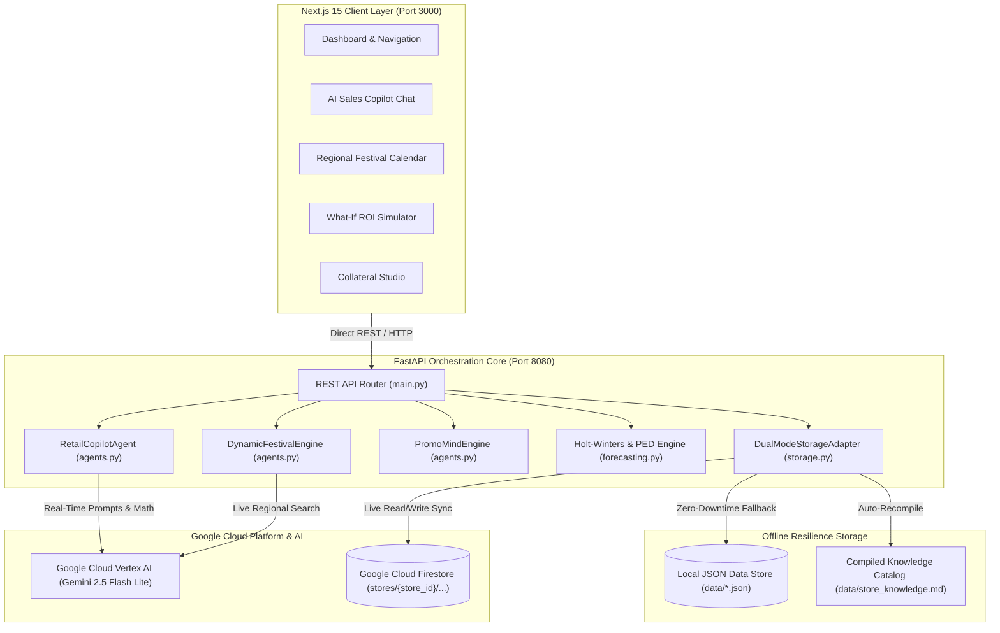

# PromoMind AI — Autonomous Retail Demand Forecasting, Dynamic AI Sales Copilot, Worldwide Festival Discovery & Capital Intelligence

> **Autonomous multi-agent demand forecasting, real-time conversational AI Sales Copilot, open-source price elasticity modeling, worldwide cultural festival planning horizons, and Dukan Capital ROI intelligence for neighborhood Kiranas & Supermarkets.**  
> *Architected for Google Cloud Platform (Vertex AI, Cloud Firestore, Cloud Run), Next.js 15, FastAPI, and Google Material Design 3.*

---

## 🌟 Key Innovations & Architecture Highlights

### 1. 🤖 Dynamic AI Retail Sales Copilot (`/api/chat`)
- **100% Dynamic Conversational Reasoning**: Powered by Google Cloud Vertex AI (`gemini-2.5-flash-lite`) using Service Account OAuth in `us-central1` with automatic API key fallback.
- **Real-Time Store Grounding**: Automatically inspects live store inventory velocities, expiring batches, and regional events directly from Firestore before generating advice.
- **Margin Safeguard Solver**: Mathematically enforces retailer-defined net margin floors (e.g., minimum 22% margin) when formulating clearance bundles.
- **Omnichannel Output**: Produces 10-second verbal cashier checkout scripts and personalized, multi-tiered customer WhatsApp broadcasts on demand.

### 2. 🪔 Worldwide Live AI Regional Festival Discovery (`/api/calendar/discover`)
- **Global Event Coverage**: Queries Google Vertex AI in real time for cultural festivals, statutory holidays, and regional shopping peaks across **India** (Karnataka, Maharashtra, Delhi-NCR, West Bengal), **Australia**, **Spain**, **Japan**, **United Kingdom**, **United States**, and worldwide.
- **Transparent Source Badging**: Festival cards in the UI explicitly indicate their provenance:
  - `LIVE_VERTEX_SA_API (gemini-2.5-flash-lite)`: Dynamically discovered in real time via live Vertex AI search.
  - `HYBRID_REGIONAL_SYNTHESIS`: High-confidence offline regional synthesis.
- **Three-Horizon Planning Deadlines**:
  - **📦 T-14 Days Advance Procurement**: Restock bulk surge SKUs before wholesale distributor mandi rates spike.
  - **🚀 T-7 Days Promo Launch**: Early-bird WhatsApp broadcast hampers and advance bookings.
  - **🧹 T+2 Days Post-Festival Clearance**: Rapid cost-price markdown on leftover seasonal items to prevent 100% inventory loss.

### 3. 💰 Dukan Capital Investment & Returns / Profit Predictor
- **Real-Time Working Capital Health**: Computes total working capital invested in inventory, projected 30-day sales turnover, and net gross profit.
- **Dead Capital at Risk**: Automatically flags working capital trapped in slow-moving SKUs (>60 days shelf life) before products expire into dead loss.
- **Cash Unlocked via Smart Promos**: Tracks fresh liquidity freed up within 12 days through algorithmic clearance bundles.
- **🔮 Interactive "What-If" ROI Simulator**: Retailers adjust **Promotional Discount Depth %** (5% to 30%) and **Expected Volume Lift %** (10% to 80%) to simulate resulting net profit rupees, turnover velocity, and capital turnover acceleration in real time.

### 4. 🧠 Open-Source Math: Price Elasticity of Demand (PED) Engine
- Built on deterministic, open-source mathematical principles without black-box dependency:
  $$\% \Delta Q = -\epsilon \cdot \% \Delta P$$
- Category-specific elasticity coefficients ($\epsilon = 0.85$ for staples, $1.70$ for packaged snacks, $2.10$ for festive gifting).
- **4 Open-Source Promotional Strategy Archetypes**:
  - `ANCHOR_MARGIN_BOOSTER`: High-velocity staple lifts high-margin slow-mover.
  - `EXPIRY_RESCUE_CLEARANCE`: Progressive markdown before shelf expiry.
  - `FESTIVE_CELEBRATION_HAMPER`: Multi-category bundles maximizing festive basket size.
  - `VOLUME_TIER_SLAB`: Bulk multi-unit purchase incentives (Buy 2+, Save More).

### 5. 🔥 Direct Google Cloud Firestore Integration (Dual-Mode Hybrid Storage Adapter)
- **Cloud Mode**: Directly reads & writes to Firestore collections under `stores/{store_id}/`:
  - `stores/{store_id}/inventory`: Real-time stock levels, MRP, cost, and velocities.
  - `stores/{store_id}/promotions`: Active/scheduled campaigns, pricing tiers, and conflict logs.
  - `stores/{store_id}/calendar_events`: Regional festive event calendar.
  - `stores/{store_id}/store_profile`: Store metadata, location, and customer list.
  - `stores/{store_id}/knowledge_catalog`: Compiled Markdown catalog (`store_knowledge.md`).
- **Offline / Local Fallback Mode**: Automatically falls back to local JSON + Markdown when running without internet or credentials, ensuring 100% zero downtime.
- **Instant Store Login (<100ms)**: Decoupled login flow serves cached regional events without blocking on synchronous AI generation during sign-in.

### 6. 📊 Interactive Slide Presentation Deck & Collateral Studio
- **Pitch Deck**: Accessible in-browser at [`frontend/public/presentation_deck.html`](frontend/public/presentation_deck.html) or at `/presentation_deck.html` on the Next.js frontend.
- **Pitch Script**: 3-minute hackathon and investor presentation guide in [`DEMO_SCRIPT.md`](DEMO_SCRIPT.md).
- **Collateral Studio**: In-app creator for WhatsApp copy and print-ready high-contrast shelf posters with barcodes.

---

## 🏗️ System Architecture



---

## 📂 Project Structure

```
promomind_ai/
├── backend/
│   ├── main.py               # FastAPI server (CORS, REST routes, auth & chat endpoints)
│   ├── agents.py             # Vertex AI Gemini live client, Copilot agent, & Festival engine
│   ├── forecasting.py        # Holt-Winters smoothing, PED optimization & Investment ROI engine
│   ├── firestore_service.py  # Google Cloud Firestore service with dual-mode fallback
│   ├── verify_gcp_creds.py   # Diagnostic verification tool for Google Cloud credentials
│   ├── storage.py            # Dual-mode store manager, CSV importer & store_knowledge.md builder
│   ├── models.py             # Pydantic schemas (StoreProfile, InvestmentROI, RegionalEvent, etc.)
│   └── mock_data.py          # Category brand curves, regional calendars, & active offers
├── frontend/                 # Modern Next.js 15 App Router Frontend
│   ├── app/
│   │   ├── layout.js         # Root layout with fonts and metadata
│   │   └── page.js           # Multi-tab single-page dashboard controller
│   ├── components/
│   │   ├── calendar/         # Regional festival calendar with AI discovery & source badges
│   │   ├── copilot/          # Dynamic AI Sales Copilot chat thread & Collateral Studio
│   │   ├── inventory/        # Stock, brand curves & dead capital monitor
│   │   ├── layout/           # Header, festive ticker bar, and navigation
│   │   ├── modals/           # LoginStoreModal with fast cached authentication
│   │   ├── profile/          # Store identity, working capital & margins
│   │   └── upload/           # POS CSV smart structuring & deduplication importer
│   ├── lib/
│   │   ├── api.js            # Direct backend API client (http://127.0.0.1:8080)
│   │   └── utils.js          # Tailwind class merging utility
│   ├── public/
│   │   └── presentation_deck.html # Interactive 9-slide presentation deck
│   └── .env.local            # Frontend environment variables (NEXT_PUBLIC_API_URL)
├── data/
│   ├── inventory_store.json  # Persistent JSON inventory database
│   ├── store_profile.json    # Store profile, regional demographic settings & capital budget
│   ├── promotions_store.json # Scheduled and active promotional bundles
│   ├── calendar_events.json  # Regional festival calendar database
│   └── store_knowledge.md    # Auto-compiled AI Knowledge Base catalog
├── tests/
│   ├── test_api.py           # Integration tests for FastAPI endpoints & CSV deduplication
│   ├── test_storage.py       # Dual-mode storage and inline credential parsing tests
│   └── test_phase2_endpoints.py # Automated end-to-end endpoint verification
├── DEMO_SCRIPT.md            # 3-Minute Hackathon & Investor Pitch Walkthrough Script
├── SETUP_AND_CLOUD_GUIDE.md  # Detailed setup, usage, & Google Cloud integration guide
├── FIRESTORE_DATA_ARCHITECTURE.md # Document schemas and security rules guide
├── Dockerfile                # Google Cloud Run container configuration
├── requirements.txt          # Python dependencies
└── README.md                 # Project documentation
```

---

## 🚀 Quick Start (Local Run)

### 1. Prerequisites
- **Python:** 3.10+ (Python 3.11/3.12 recommended)
- **Node.js:** 18.17+ (Node 20+ recommended)
- **Git**

### 2. Backend Setup (FastAPI)

```bash
# 1. Clone repository
git clone https://github.com/Nitish-007/PromoMind_Ai.git
cd promomind_ai

# 2. Create virtual environment
python -m venv venv
# On Windows PowerShell:
.\venv\Scripts\Activate.ps1
# On macOS/Linux:
source venv/bin/activate

# 3. Install Python dependencies
pip install -r requirements.txt

# 4. Configure environment (.env)
# Create a .env file with your Google Cloud Service Account JSON:
# FIRESTORE_SA_JSON={"type": "service_account", "project_id": "...", ...}
# GEMINI_API_KEY=AIzaSy... (optional backup)

# 5. Start the backend server on port 8080
python backend/main.py
```
Backend will start on: 👉 `http://127.0.0.1:8080`

### 3. Frontend Setup (Next.js 15)

In a separate terminal:
```bash
# 1. Navigate to frontend directory
cd frontend

# 2. Install dependencies
npm install

# 3. Configure frontend environment (.env.local)
# Ensure NEXT_PUBLIC_API_URL points to the FastAPI backend:
echo "NEXT_PUBLIC_API_URL=http://127.0.0.1:8080" > .env.local

# 4. Start Next.js development server
npm run dev
```
Frontend will start on: 👉 `http://localhost:3000`

---

## ☁️ Google Cloud Vertex AI & Firestore Setup

PromoMind AI operates in **Dual-Mode**: It runs out-of-the-box in local offline mode and automatically enables live Google Cloud Firestore synchronization and Vertex AI reasoning the moment credentials are placed.

### Service Account Setup:
1. Open [Google Cloud Console](https://console.cloud.google.com/).
2. Select or create your Google Cloud project.
3. Enable the following APIs:
   - **Cloud Firestore API**
   - **Vertex AI API**
4. Navigate to **IAM & Admin** → **Service Accounts** → Create Service Account:
   - Assign roles: `Cloud Datastore User` and `Vertex AI User`.
   - Click **Manage Keys** → **Add Key** → **Create new key (JSON)**.
5. In your `.env` file, supply the JSON:
   ```env
   FIRESTORE_SA_JSON='{"type":"service_account","project_id":"your-project","private_key":"...","client_email":"..."}'
   ```
6. Verify credentials:
   ```bash
   python backend/verify_gcp_creds.py
   ```

---

## 🔌 API Endpoints Summary

| Method | Endpoint | Description |
|---|---|---|
| `POST` | `/api/chat` | **AI Sales Copilot**: Real-time Vertex AI conversational retail reasoning |
| `POST` | `/api/calendar/discover` | **Live AI Festival Search**: Dynamically discover regional festivals via Vertex AI |
| `GET` | `/api/calendar/events` | Multi-horizon regional festival events (`?region=...&country=...`) |
| `POST` | `/api/auth/login` | Instant store authentication with non-blocking festival loading |
| `GET` | `/api/auth/store-exists` | Checks if a store ID exists in Firestore or local storage |
| `GET` | `/api/health` | Service health status and storage configuration telemetry |
| `GET` | `/api/storage/status` | Hybrid storage adapter telemetry (Cloud vs Local, Firestore collections) |
| `GET` | `/api/store/financial-roi` | Dukan Capital ROI metrics (turnover, net profit, dead capital risk) |
| `POST` | `/api/store/simulate-roi` | "What-If" ROI simulation (adjust discount depth & volume lift) |
| `GET` | `/api/inventory` | Retailer inventory, velocities, cost, MRP, and stock status |
| `POST` | `/api/products` | Add new SKU, run Holt-Winters forecasts, and sync AI Knowledge Base |
| `GET` | `/api/inventory/{id}/brand-comparison` | Multi-brand sales curves (e.g., Amul vs Nandini vs Mother Dairy) |
| `GET` | `/api/offers/active` | Currently scheduled and active in-store promotional offers |
| `POST` | `/api/offers/check-conflict` | Prevents margin cannibalization and overlapping promotions |
| `POST` | `/api/generate-combo` | Dynamic promo generation with strategy archetypes & cashier pitch |
| `POST` | `/api/publish-offer` | Dispatches offer to POS and schedules in store calendar |
| `POST` | `/api/upload-csv` | Parses retailer CSV, runs Holt's models, and deduplicates SKUs |
| `GET` | `/api/knowledge-md` | View or download the auto-compiled AI knowledge markdown file |

---

## 🧪 Automated Test Suite

Run the full end-to-end integration test suite:
```bash
# Run all tests
python -m unittest discover tests

# Or run individual test modules
python tests/test_api.py
python tests/test_storage.py
python tests/test_phase2_endpoints.py
```

---

*PromoMind AI — Empowering Neighborhood Retailers with Intelligent Demand Forecasting & Google Cloud AI.*
