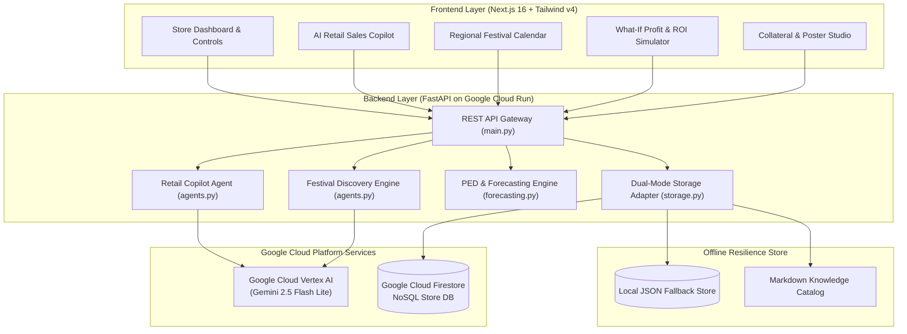

# PromoMind AI
### Autonomous Retail Demand Forecasting, Dynamic AI Sales Copilot & Capital Intelligence
> **Built for the Google AI Builder Cup Hackathon**  
> *Empowering independent supermarkets, kiranas, and neighborhood grocers with enterprise-grade demand forecasting, margin protection, and 24/7 AI-powered sales intelligence.*

---

[](https://cloud.google.com/)
[](https://deepmind.google/technologies/gemini/)
[](https://fastapi.tiangolo.com/)
[](https://nextjs.org/)
[](https://www.docker.com/)
[](https://github.com/features/actions)
[](PASTE_YOUR_DRIVE_LINK_HERE)

---

## Video Demo & Walkthrough

**Watch the full end-to-end product demo & walkthrough:**  
**Google Drive Link**: [Watch PromoMind AI Demo Video](https://drive.google.com/file/d/1k9QPU--VemPFdAjvk4XIM09x5vGEN3ed/view?usp=sharing)

---

## What is PromoMind AI?

Independent supermarkets, neighborhood grocers, and regional retail marts operate on razor-thin net margins (typically 15%–25%). Unlike retail conglomerates (e.g., Walmart, Target, Reliance Retail) with multi-million-dollar ERPs and dedicated data science departments, local merchants face severe structural challenges:

1. **Trapped Working Capital**: Slow-moving inventory (>60 days on shelf) locks up vital cash flow, often leading to expired stock and 100% margin write-offs.
2. **Missed Cultural Surges**: Hyperlocal cultural festivals and holidays trigger sudden demand spikes that merchants fail to procure in advance, leading to stockouts and lost revenue.
3. **Discount Cannibalization**: Retailers run overlapping, uncoordinated promotional discounts that cannibalize their best-selling products without clearing dead stock.
4. **Lack of Operational Bandwidth**: Store owners and floor cashiers lack the time and analytical tools to create persuasive bundle pitches and tailored customer marketing.

**PromoMind AI bridges this enterprise divide.**

PromoMind AI is an autonomous retail demand forecasting and profit optimization platform powered by **Google Cloud Vertex AI (Gemini 2.5)**, **Cloud Run**, and **Cloud Firestore**. It equips independent retailers with an intelligent AI Sales Copilot, dynamic regional festival demand planning, Price Elasticity of Demand (PED) algorithmic bundles, and an interactive Store Capital "What-If" ROI Simulator—all within a fast, intuitive web interface.

---

## Key Highlights & Core Capabilities

### 1. Dynamic AI Retail Sales Copilot
- Grounded in real-time store inventory, expiring stock batches, and active sales velocities.
- Powered by Google Vertex AI (`gemini-2.5-flash-lite`) via secure Service Account authentication with automatic API key fallback.
- Enforces strict mathematical **margin floors** (e.g., never recommend a promotion below 20% net margin).
- Generates instant **10-second verbal cashier checkout scripts** and high-converting, personalized **WhatsApp customer broadcast copy**.

### 2. Regional & Worldwide Festival Surge Engine
- Dynamically discovers upcoming regional cultural festivals, public holidays, and shopping events in real time.
- Implements **Three-Horizon Planning**:
  - **T-14 Days Advance Procurement**: Restock high-surge SKUs before wholesale supplier rates spike.
  - **T-7 Days Promo Launch**: Pre-orders, gift hampers, and early-bird promotional campaigns.
  - **T+2 Days Post-Festival Clearance**: Rapid cost-price markdown strategies to clear excess perishable inventory with zero dead-stock write-off.

### 3. Store Capital Intelligence & "What-If" ROI Simulator
- Real-time working capital tracking: Computes invested inventory capital, 30-day projected turnover, and dead capital at risk.
- **Interactive "What-If" Simulator**: Retailers adjust **Discount Depth %** (5%–30%) and **Expected Volume Lift %** (10%–80%) to immediately simulate net profit rupees, turnover velocity, and liquidity impact before publishing promotions.

### 4. Open-Source Math: Price Elasticity of Demand (PED)
- Deterministic, verifiable economic modeling:
  $$\% \Delta Q = -\epsilon \cdot \% \Delta P$$
- Category-tuned elasticity coefficients ($\epsilon = 0.85$ for everyday staples, $1.70$ for snacks/beverages, $2.10$ for festival hampers).
- Employs 4 strategic promotional archetypes:
  - `ANCHOR_MARGIN_BOOSTER`: Pair high-velocity staples with high-margin slow-movers.
  - `EXPIRY_RESCUE_CLEARANCE`: Progressive markdown ladders before shelf expiry.
  - `FESTIVE_CELEBRATION_HAMPER`: Multi-category celebratory bundles.
  - `VOLUME_TIER_SLAB`: Bulk purchase incentives (Buy 2+, Save More).

### 5. Cloud-Native Dual-Mode Hybrid Storage & Multi-Tenancy
- Direct integration with **Google Cloud Firestore** (`stores/{store_id}/*`).
- **Multi-Tenant Store Isolation**: Each merchant account manages isolated store branches with dedicated inventory and promotion collections. Newly created stores initialize cleanly without demo data contamination, complete with empty-state guidance.
- **Preset Demo Stores**: Demonstration stores (e.g., `sharma_supermarket_01`) remain pre-seeded with sample inventory, brand curves, and scheduled offers for immediate out-of-the-box evaluation.
- **POS & Distributor Spreadsheet Intake**: Drag-and-drop intake supporting both CSV and Excel (`.xlsx`, `.xls`) files with automated column mapping (Name, Category, Stock, Cost, MRP, Velocity, WhatsApp) and in-place deduplication.
- **Zero-Downtime Resilience**: Seamlessly operates in offline mode with local JSON and markdown knowledge persistence when credentials or connectivity are absent.
- **Instant Authentication (<100ms)**: Non-blocking signup and login with background pre-caching of regional festival discovery.

---

## System Architecture



---

## Tech Stack

| Domain | Tech / Service | Role |
|---|---|---|
| **LLM Model** | **Google Cloud Vertex AI** (`gemini-2.5-flash-lite`) | Real-time conversational retail reasoning, dynamic festival discovery, and omnichannel marketing copy synthesis. |
| **Database** | **Google Cloud Firestore** | Scalable, real-time cloud document store for multi-store inventories, promotions, calendars, and merchant profiles. |
| **Serverless Compute** | **Google Cloud Run** | Fully managed container runtime hosting both the FastAPI backend and Next.js frontend with auto-scaling to zero. |
| **Container Registry** | **Google Artifact Registry** | Secure, automated container image repository for Docker builds. |
| **Backend Framework** | **FastAPI (Python 3.11)** | High-performance asynchronous REST API backend with Pydantic v2 data validation. |
| **Quantitative Forecasting**| **Native Statistical Engine** | Double Exponential Smoothing (Holt's Linear Trend), Seasonal Multipliers, and Price Elasticity of Demand (PED) solvers. |
| **Frontend Framework** | **Next.js 16 (App Router)** | Modern SSR/CSR hybrid React 19 web dashboard built with Tailwind CSS v4 and Lucide Icons. |
| **CI/CD & DevOps** | **GitHub Actions + Docker** | Automated multi-stage Docker builds and continuous deployment to Cloud Run with path-based trigger filters. |

---

## Core API Endpoints

| Category | Method | Endpoint | Description |
|---|---|---|---|
| **Auth & Stores** | `POST` | `/api/auth/signup` | Register new merchant user account (Name, Email, Password, Phone) |
| | `POST` | `/api/auth/signin` | Authenticate merchant and establish active store session |
| | `GET` | `/api/auth/me` | Retrieve merchant account profile and all associated store branches |
| | `POST` | `/api/stores` | Create a new store branch with custom location, margin floor, and capital budget |
| **AI & Copilot** | `POST` | `/api/chat` | AI Sales Copilot reasoning with live store inventory grounding |
| | `POST` | `/api/calendar/discover`| Real-time AI festival and holiday discovery via Gemini 2.5 |
| | `GET` | `/api/calendar/events` | Retrieve scheduled regional events with 3-horizon planning windows |
| **Financial & ROI** | `GET` | `/api/store/financial-roi` | Store capital health: turnover velocity, gross profit, dead capital risk |
| | `POST` | `/api/store/simulate-roi` | Interactive "What-If" simulator (discount depth vs. volume lift) |
| **Inventory & Offers**| `GET` | `/api/inventory` | Real-time stock levels, MRP, cost, category brand curves, and velocities |
| | `POST` | `/api/upload-csv` | Ingest retail POS CSV or Excel (.xlsx / .xls) spreadsheets with automatic deduplication & forecasting updates |
| | `POST` | `/api/generate-combo` | Algorithmic bundle creator with margin safeguard & cashier pitches |
| | `POST` | `/api/offers/check-conflict`| Margin safeguard engine preventing overlapping discount cannibalization |
| | `GET` | `/api/health` | Health check endpoint returning Cloud vs. Local storage telemetry |

---

## Repository Structure

```
PromoMind_Ai/
├── backend/
│   ├── main.py                 # FastAPI application & REST endpoint routing
│   ├── agents.py               # Gemini 2.5 Vertex AI client & Copilot agents
│   ├── forecasting.py          # Holt-Winters smoothing, PED optimization & ROI simulator
│   ├── firestore_service.py    # Google Cloud Firestore integration layer
│   ├── storage.py              # Dual-mode hybrid storage adapter & CSV intake
│   ├── models.py               # Pydantic data contracts & request schemas
│   ├── mock_data.py            # Regional calendars, brand curves & seed items
│   ├── verify_gcp_creds.py     # GCP credentials diagnostic verification utility
│   ├── Dockerfile              # Production Python 3.11 container for Cloud Run
│   ├── requirements.txt        # Backend Python dependencies
│   └── data/                   # Persistent local fallback store & knowledge base
├── frontend/
│   ├── app/                    # Next.js 16 App Router pages & root layout
│   ├── components/
│   │   ├── copilot/            # AI Copilot chat interface & Collateral Studio
│   │   ├── calendar/           # Regional festival calendar with AI discovery badges
│   │   ├── inventory/          # Inventory table, brand curves & dead capital alerts
│   │   ├── modals/             # Authentication & store creation modals
│   │   ├── profile/            # Store profile, capital budgets & margin floors
│   │   └── upload/             # POS CSV & Excel (.xlsx) intake & data preview
│   ├── lib/api.js              # Centralized backend HTTP client
│   ├── public/                 # Static assets, branding icons & slide deck
│   ├── Dockerfile              # Multi-stage Next.js production container for Cloud Run
│   └── package.json            # Frontend dependencies & scripts
├── .github/workflows/
│   └── deploy.yaml             # GitHub Actions CI/CD to Google Cloud Run
├── tests/                      # Automated unit and integration test suite
└── README.md                   # Project documentation
```

---

## Getting Started (Local Development)

### Prerequisites
- **Python**: 3.11 or higher
- **Node.js**: 18.17 or higher (Node 20+ recommended)
- **Git**

### 1. Backend Setup (FastAPI)
```bash
# 1. Clone repository
git clone https://github.com/Nitish-007/PromoMind_Ai.git
cd PromoMind_Ai

# 2. Create and activate a virtual environment
python -m venv venv
source venv/bin/activate       # On Windows: .\venv\Scripts\Activate.ps1

# 3. Install Python dependencies
pip install -r backend/requirements.txt

# 4. (Optional) Provide Google Cloud credentials in backend/.env:
# FIRESTORE_SA_JSON={"type": "service_account", "project_id": "...", ...}
# GEMINI_API_KEY=AIzaSy...

# 5. Start the FastAPI server
python backend/main.py
```
Backend runs at: `http://127.0.0.1:8080` (Interactive docs at `/docs`)

### 2. Frontend Setup (Next.js 16)
```bash
# In a new terminal window:
cd frontend

# 1. Install Node dependencies
npm install

# 2. Point frontend to the local backend
echo "NEXT_PUBLIC_API_URL=http://127.0.0.1:8080" > .env.local

# 3. Start Next.js development server
npm run dev
```
Frontend runs at: `http://localhost:3000`

---

## Deployment Architecture (Google Cloud Run & CI/CD)

PromoMind AI is architected for seamless cloud deployment via **GitHub Actions** and **Google Cloud Run**:

1. **Path-Filtered CI/CD**: The workflow in `.github/workflows/deploy.yaml` triggers automatically on pushes to `main` only when changes occur in `backend/**`, `frontend/**`, or the workflow itself—preventing unnecessary deployments.
2. **Staged Microservice Rollout**:
   - **Backend Deployment**: Builds the backend container, pushes to Google Artifact Registry, and deploys to Cloud Run with a custom service account deployer account with appropriate permissions for secure access to Firestore and Vertex AI.
   - **Dynamic Frontend Binding**: Captures the live backend Cloud Run URL and injects it into the Next.js multi-stage build (`NEXT_PUBLIC_BACKEND_URL`), ensuring zero hardcoded endpoints.